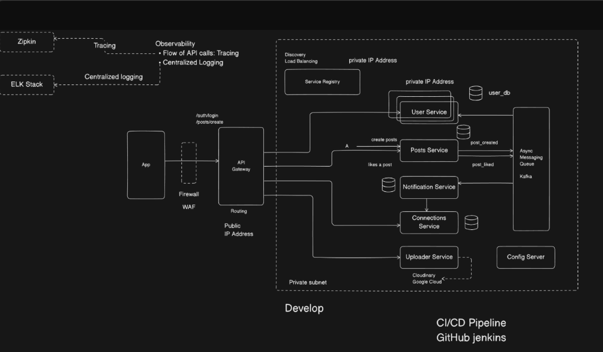
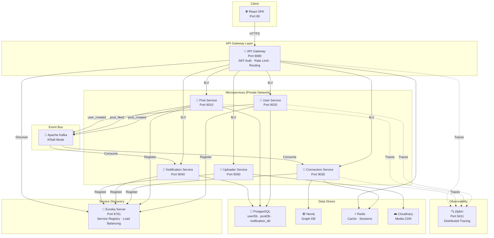
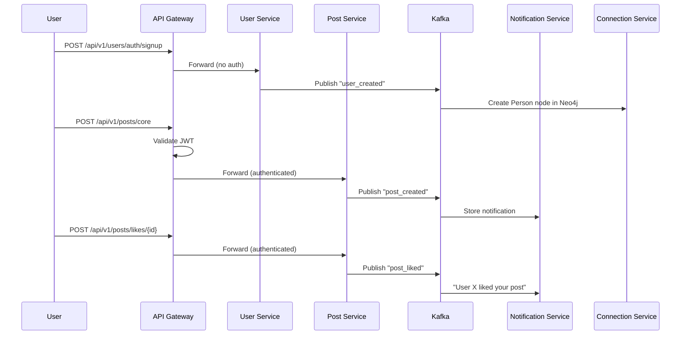
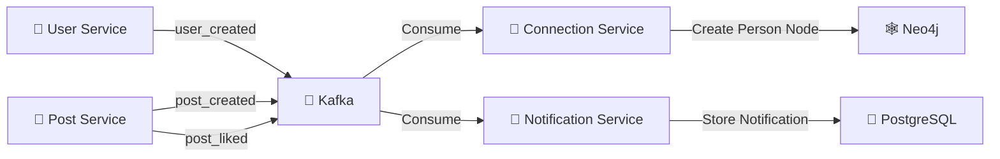

<p align="center">
  
</p>

<h1 align="center">MyLinkedin</h1>

<p align="center">
  <b>An open-source professional networking platform built with microservices</b>
  <br/>
  <sub>Spring Boot 4 · React 18 · Kafka · Neo4j · PostgreSQL · Redis · Docker · Kubernetes</sub>
</p>

<p align="center">
  
  
  
  
  
  
  <br/>
  <a href="https://github.com/nims-creation/MyLinkedein/actions/workflows/ci.yml">
    
  </a>
</p>

<p align="center">
  <a href="CONTRIBUTING.md"><b>🤝 Contribute</b></a> ·
  <a href="https://github.com/nims-creation/MyLinkedein/issues?q=is%3Aissue%20is%3Aopen%20label%3A%22good%20first%20issue%22">Good First Issues</a> ·
  <a href="https://github.com/nims-creation/MyLinkedein/issues/new/choose">Suggest a Feature / Report a Bug</a> ·
  <a href="SECURITY.md">Security Policy</a>
</p>

---

## 📋 Table of Contents

- [Overview](#-overview)
- [System Architecture](#-system-architecture)
- [Tech Stack](#-tech-stack)
- [Microservices](#-microservices)
- [API Reference](#-api-reference)
- [Event-Driven Architecture](#-event-driven-architecture)
- [Database Design](#-database-design)
- [Getting Started](#-getting-started)
- [Docker Deployment](#-docker-deployment)
- [Kubernetes Deployment](#-kubernetes-deployment)
- [Project Structure](#-project-structure)
- [Future Roadmap](#-future-roadmap)
- [Contributing](#-contributing)

---

## 🎯 Overview

**MyLinkedin** is an open-source full-stack professional networking platform inspired by LinkedIn, built around **microservices architecture**. It explores event-driven communication, graph-based social connections, and containerized deployment. **The project is under active development:** contributors are welcome, and production readiness and automated test coverage should not be assumed.

### Key Highlights

- 🏗️ **7 Spring Boot components** — 5 domain services, an API Gateway, and a Eureka discovery server
- 📡 **Event-Driven Architecture** — Kafka for async communication between services
- 🕸️ **Graph Database** — Neo4j for social connections (1st-degree, 2nd-degree, recommendations)
- 🔐 **JWT Authentication** — secure, stateless auth with token versioning & password reset
- ⚡ **Redis Caching** — session management and rate limiting at API Gateway
- 🔍 **Distributed Tracing** — Zipkin + Micrometer for end-to-end request tracing
- ☁️ **Cloud-Native** — fully containerized with Docker Compose & Kubernetes manifests
- 🔄 **Service Discovery** — Netflix Eureka for dynamic service registration & load balancing
- 🚀 **CI/CD Pipeline** — GitHub Actions for builds and Docker image publishing; backend tests are currently skipped in CI ([tracking issue](https://github.com/nims-creation/MyLinkedein/issues/5))

---

## 🏛️ System Architecture

### High-Level Architecture

<p align="center">
  
</p>

### Architecture Flow (Mermaid)



---

## 🛠️ Tech Stack

| Layer | Technology | Purpose |
|-------|-----------|---------|
| **Frontend** | React 18, Vite, React Router 7 | Single Page Application |
| **API Gateway** | Spring Cloud Gateway | Routing, JWT Auth, Rate Limiting |
| **Backend** | Spring Boot 4.x, Java 21 | Microservices |
| **Service Discovery** | Netflix Eureka | Registration & Load Balancing |
| **Messaging** | Apache Kafka (KRaft) | Async Event-Driven Communication |
| **Relational DB** | PostgreSQL 16 | Users, Posts, Notifications |
| **Graph DB** | Neo4j 5 | Social Connections & Relationships |
| **Cache** | Redis 7 | Sessions, Rate Limiting |
| **Media Storage** | Cloudinary | Image & File CDN |
| **Containerization** | Docker, Docker Compose | Multi-container orchestration |
| **Orchestration** | Kubernetes | Production deployment manifests |
| **CI/CD** | GitHub Actions | Automated build, test & Docker push |
| **Tracing** | Zipkin + Micrometer Brave | Distributed tracing & log correlation |
| **Build Tool** | Maven (mvnw) | Dependency management & build |

---

## 🧩 Microservices

### Service Overview

| Service | Port | Database | Responsibilities |
|---------|------|----------|-----------------|
| **discovery-server** | 8761 | — | Eureka service registry & health dashboard |
| **api-gateway** | 8080 | Redis | JWT authentication, request routing, rate limiting |
| **user-service** | 9020 | PostgreSQL (`userDb`) | Sign up, login, password reset, JWT tokens |
| **post-service** | 9010 | PostgreSQL (`postDb`) | Create/read posts, like/unlike, Kafka events |
| **connection-service** | 9030 | Neo4j + Redis | Send/accept/reject connection requests, graph queries |
| **notification-service** | 9040 | PostgreSQL (`notification_db`) | Kafka consumer, notification persistence |
| **uploader-service** | 9050 | Cloudinary | File upload to Cloudinary CDN |
| **frontend** | 80 | — | React SPA served by Nginx |

### Inter-Service Communication



---

## 📡 API Reference

### 🔐 Authentication (`/api/v1/users`)

| Method | Endpoint | Auth | Description |
|--------|----------|------|-------------|
| `POST` | `/auth/signup` | ❌ | Register new user |
| `POST` | `/auth/login` | ❌ | Login → returns JWT token |
| `POST` | `/auth/forgot-password` | ❌ | Request password reset link |
| `POST` | `/auth/reset-password` | ❌ | Reset password with token |

### 📝 Posts (`/api/v1/posts`)

| Method | Endpoint | Auth | Description |
|--------|----------|------|-------------|
| `POST` | `/core` | ✅ | Create a new post |
| `GET` | `/core/{postId}` | ✅ | Get post by ID |
| `GET` | `/core/users/{userId}/allPosts` | ✅ | Get all posts of a user |
| `POST` | `/likes/{postId}` | ✅ | Like a post |
| `DELETE` | `/likes/{postId}` | ✅ | Unlike a post |

### 🤝 Connections (`/api/v1/connections`)

| Method | Endpoint | Auth | Description |
|--------|----------|------|-------------|
| `GET` | `/core/{userId}/first-degree` | ✅ | Get 1st-degree connections |
| `POST` | `/core/request/{userId}` | ✅ | Send connection request |
| `POST` | `/core/accept/{userId}` | ✅ | Accept connection request |
| `POST` | `/core/reject/{userId}` | ✅ | Reject connection request |

### 📁 Uploader (`/api/v1/upload`)

| Method | Endpoint | Auth | Description |
|--------|----------|------|-------------|
| `POST` | `/file` | ✅ | Upload file → returns CDN URL |

---

## 📨 Event-Driven Architecture

MyLinkedin uses **Apache Kafka** for asynchronous, decoupled communication between services.

### Kafka Events

| Event | Producer | Consumer(s) | Payload |
|-------|----------|-------------|---------|
| `user_created` | user-service | connection-service | `{ userId, name }` |
| `post_created` | post-service | notification-service | `{ ownerUserId, postId, userId, content }` |
| `post_liked` | post-service | notification-service | `{ postId, ownerUserId, likeByUserId }` |

### Event Flow



---

## 🗄️ Database Design

### PostgreSQL — `userDb`

```
┌──────────────────────┐
│       users          │
├──────────────────────┤
│ id           BIGINT  │ PK, AUTO_INCREMENT
│ name         VARCHAR │ NOT NULL
│ email        VARCHAR │ NOT NULL, UNIQUE
│ password     VARCHAR │ NOT NULL (BCrypt)
│ tokenVersion INTEGER │ DEFAULT 0
└──────────────────────┘

┌──────────────────────────┐
│   password_reset_token   │
├──────────────────────────┤
│ id           BIGINT      │ PK
│ token        VARCHAR     │
│ user_id      BIGINT      │ FK → users
│ expiry_date  TIMESTAMP   │
└──────────────────────────┘
```

### PostgreSQL — `postDb`

```
┌──────────────────────┐       ┌──────────────────────┐
│       post           │       │     post_like        │
├──────────────────────┤       ├──────────────────────┤
│ id         BIGINT    │ PK    │ id         BIGINT    │ PK
│ content    TEXT       │       │ post_id    BIGINT    │ FK
│ user_id    BIGINT    │       │ user_id    BIGINT    │
│ created_at TIMESTAMP │       │ created_at TIMESTAMP │
└──────────────────────┘       └──────────────────────┘
```

### Neo4j — Graph Model

```
(:Person {userId, name})
        |
   [:CONNECTED_TO]  ←── 1st degree connection
        |
(:Person {userId, name})
```

### PostgreSQL — `notification_db`

```
┌──────────────────────┐
│    notification      │
├──────────────────────┤
│ id         BIGINT    │ PK
│ user_id    BIGINT    │
│ message    TEXT      │
│ created_at TIMESTAMP │
└──────────────────────┘
```

---

## 🚀 Getting Started

### Prerequisites

- **Java 21** (JDK)
- **Docker Desktop** (latest)
- **Git**

### Quick Start (Docker Compose — Recommended)

```bash
# 1. Clone the repository
git clone https://github.com/nims-creation/MyLinkedein.git
cd MyLinkedin

# 2. Create environment file
cp .env.example .env
# Edit .env with your values (DB passwords, Cloudinary keys, JWT secret)

# 3. Build and start everything
docker compose up --build -d

# 4. Wait ~90 seconds for all services to start, then verify
docker compose ps
```

### Access Points

| Service | URL |
|---------|-----|
| 🌐 **Frontend** | [http://localhost](http://localhost) |
| 📡 **Eureka Dashboard** | [http://localhost:8761](http://localhost:8761) |
| 🚪 **API Gateway** | [http://localhost:8080](http://localhost:8080) |
| 🕸️ **Neo4j Browser** | [http://localhost:7474](http://localhost:7474) |
| 🔍 **Zipkin Tracing UI** | [http://localhost:9411](http://localhost:9411) |

### Environment Variables (`.env`)

```env
# Database
DB_PASSWORD=your_db_password

# Redis
REDIS_PASSWORD=your_redis_password

# Neo4j
NEO4J_PASSWORD=your_neo4j_password

# JWT
JWT_SECRET_KEY=your_jwt_secret

# Cloudinary
CLOUDINARY_CLOUD_NAME=your_cloud_name
CLOUDINARY_API_KEY=your_api_key
CLOUDINARY_API_SECRET=your_api_secret
```

---

## 🐳 Docker Deployment

### Architecture in Docker

All services run as isolated containers connected via Docker networking:

```
┌─────────────────────────────────────────────────────┐
│                 Docker Network                       │
│                                                      │
│  ┌──────────┐  ┌──────────┐  ┌──────────┐          │
│  │ Postgres │  │  Neo4j   │  │  Kafka   │          │
│  │  :5432   │  │  :7687   │  │  :9092   │          │
│  └──────────┘  └──────────┘  └──────────┘          │
│  ┌──────────┐  ┌──────────┐  ┌──────────┐          │
│  │  Redis   │  │ Eureka   │  │  Zipkin  │          │
│  │  :6379   │  │  :8761   │  │  :9411   │          │
│  └──────────┘  └──────────┘  └──────────┘          │
│       ↕              ↕              ↕               │
│  ┌──────────┐  ┌──────────┐  ┌──────────┐          │
│  │ Gateway  │  │ User Svc │  │ Post Svc │          │
│  │  :8080   │  │  :9020   │  │  :9010   │          │
│  └──────────┘  └──────────┘  └──────────┘          │
│  ┌──────────┐  ┌──────────┐  ┌──────────┐          │
│  │ Conn Svc │  │Notif Svc │  │Upload Svc│          │
│  │  :9030   │  │  :9040   │  │  :9050   │          │
│  └──────────┘  └──────────┘  └──────────┘          │
│  ┌────────────────────────────────────────┐         │
│  │          Frontend (Nginx :80)          │         │
│  └────────────────────────────────────────┘         │
└─────────────────────────────────────────────────────┘
```

### Docker Commands

```bash
# Build all images
docker compose build

# Start all services
docker compose up -d

# View logs
docker compose logs -f [service-name]

# Stop everything
docker compose down

# Full reset (delete volumes)
docker compose down -v
```

---

## ☸️ Kubernetes Deployment

Production-ready K8s manifests are included in the `k8s/` directory.

### Directory Structure

```
k8s/
├── namespace.yaml                    # mylinkedin namespace
├── deploy.sh                         # One-click deploy script
├── secrets/
│   └── app-secrets.yaml              # Base64 encoded secrets
├── configmaps/
│   └── app-config.yaml               # Service URLs, ports
├── infrastructure/
│   ├── postgres.yaml                  # StatefulSet + PVC
│   ├── redis.yaml                     # StatefulSet + PVC
│   ├── neo4j.yaml                     # StatefulSet + PVC
│   ├── kafka.yaml                     # StatefulSet + PVC
│   ├── zipkin.yaml                    # Deployment + Service (tracing)
│   └── postgres-init-configmap.yaml   # Multi-DB init script
├── services/
│   ├── discovery-server.yaml          # Deployment (1 replica)
│   ├── api-gateway.yaml               # Deployment (2 replicas)
│   ├── user-service.yaml              # Deployment (2 replicas)
│   ├── post-service.yaml              # Deployment (2 replicas)
│   ├── connection-service.yaml        # Deployment (2 replicas)
│   ├── notification-service.yaml      # Deployment (2 replicas)
│   └── uploader-service.yaml          # Deployment (2 replicas)
├── frontend/
│   └── frontend.yaml                  # Deployment (2 replicas)
└── ingress/
    └── ingress.yaml                   # ALB Ingress (AWS)
```

### Deploy to Kubernetes

```bash
# Apply all manifests in order
bash k8s/deploy.sh

# Or manually:
kubectl apply -f k8s/namespace.yaml
kubectl apply -f k8s/secrets/
kubectl apply -f k8s/configmaps/
kubectl apply -f k8s/infrastructure/
kubectl apply -f k8s/services/
kubectl apply -f k8s/frontend/
kubectl apply -f k8s/ingress/

# Check status
kubectl get all -n mylinkedin
```

---

## 📂 Project Structure

```
MyLinkedin/
├── 📁 .github/workflows/           # CI/CD Pipeline
│   ├── ci.yml                       # Build + Test + Docker Push
│   └── pr-check.yml                 # PR Validation
├── 📁 api-gateway/              # Spring Cloud Gateway (JWT + Routing)
│   └── src/main/
├── 📁 discovery-server/         # Netflix Eureka Server
│   └── src/main/
├── 📁 user-service/             # Authentication & User Management
│   └── src/main/
├── 📁 post-service/             # Posts CRUD + Likes + Kafka Producer
│   └── src/main/
├── 📁 ConnectionService/        # Neo4j Graph-based Connections
│   └── src/main/
├── 📁 notification-service/     # Kafka Consumer + Notifications
│   └── src/main/
├── 📁 uploader-service/         # Cloudinary File Upload
│   └── src/main/
├── 📁 mylinkedin-frontend/      # React 18 + Vite SPA
│   └── src/
├── 📁 infrastructure/           # Docker infra configs
│   └── postgres/init-multiple-dbs.sh
├── 📁 k8s/                      # Kubernetes manifests
│   ├── namespace.yaml
│   ├── deploy.sh
│   ├── secrets/
│   ├── configmaps/
│   ├── infrastructure/
│   ├── services/
│   ├── frontend/
│   └── ingress/
├── 📁 docs/                     # Architecture diagrams
│   ├── system-design.png
│   └── logo.svg
├── 📄 docker-compose.yml        # Full-stack Docker Compose
├── 📄 .env.example              # Environment template
├── 📄 .gitignore
└── 📄 README.md                 # ← You are here
```

---

## 🗺️ Future Roadmap

### ✅ Completed
- [x] **Distributed Tracing** — Zipkin + Micrometer Brave across all microservices
- [x] **CI/CD Pipeline** — GitHub Actions for parallel builds and Docker image publishing to GHCR (automated backend test enforcement is [planned](https://github.com/nims-creation/MyLinkedein/issues/5))
- [x] **Kubernetes Manifests** — Production-ready K8s deployment with StatefulSets, Deployments & Ingress
- [x] **Dockerization** — Multi-stage Docker builds for all services + Docker Compose orchestration
- [x] **Cloudinary Integration** — Media upload via CDN (replaced Google Cloud Storage)

### 🔮 Planned
- [ ] **Config Server** — Spring Cloud Config for centralized configuration
- [ ] **ELK Stack** — Elasticsearch + Logstash + Kibana for centralized logging
- [ ] **Search Service** — Elasticsearch for user/post search
- [ ] **Messaging Service** — Real-time chat using WebSockets
- [ ] **Feed Algorithm** — Personalized feed based on connections & interactions
- [ ] **Profile Photos** — Integrate uploader-service with user profiles
- [ ] **Comments** — Comment on posts with threaded replies

---

## 🧑‍💻 Contributing

**We welcome contributions!** Whether you are learning Java, exploring microservices, improving React accessibility, or working with distributed systems, there is room to help. MyLinkedin is an evolving community project, and thoughtful feedback is just as valuable as code.

### 🚀 Your first contribution

1. **Read [CONTRIBUTING.md](CONTRIBUTING.md)** for prerequisites, setup, branch naming, coding guidelines, and testing expectations.
2. **Choose a task:** browse [good first issues](https://github.com/nims-creation/MyLinkedein/issues?q=is%3Aissue%20is%3Aopen%20label%3A%22good%20first%20issue%22) or [help-wanted issues](https://github.com/nims-creation/MyLinkedein/issues?q=is%3Aissue%20is%3Aopen%20label%3A%22help%20wanted%22).
3. **Comment on the issue** to discuss the approach and avoid overlapping work. For major features or architectural changes, agree on a scope before writing code.
4. **Fork, create a focused branch, and open a PR** against `main`. Link the issue and describe what changed, why, and how you tested it. GitHub will provide our [Pull Request template](.github/PULL_REQUEST_TEMPLATE.md).

### 🧩 Where you can help

| Area | Example contributions | Start here |
| --- | --- | --- |
| Documentation | Setup instructions and troubleshooting | [#2](https://github.com/nims-creation/MyLinkedein/issues/2), [#3](https://github.com/nims-creation/MyLinkedein/issues/3) |
| Frontend & accessibility | Improve keyboard interactions and labels | [#4](https://github.com/nims-creation/MyLinkedein/issues/4) |
| Testing & CI | Enable real backend test execution on PRs | [#5](https://github.com/nims-creation/MyLinkedein/issues/5) |
| Event-driven reliability | Design retry-safe Kafka consumers | [#6](https://github.com/nims-creation/MyLinkedein/issues/6) |
| Search & discovery | Search for people and posts | [#7](https://github.com/nims-creation/MyLinkedein/issues/7) |
| Feed & ranking | Connection-aware home feed | [#8](https://github.com/nims-creation/MyLinkedein/issues/8) |

These are **open proposals**, not finished features. Please review each issue's requirements and discuss large design changes before implementing them.

### 💡 Suggest a feature or report a bug

Use the [Issue chooser](https://github.com/nims-creation/MyLinkedein/issues/new/choose) to submit a structured **Feature Request** or **Bug Report**. For feature ideas, explain the user problem and expected behavior. For bugs, include reproduction steps, expected vs. actual results, and sanitized logs when possible.

**Do not post vulnerabilities or credentials publicly.** Follow our [Security Policy](SECURITY.md) for coordinated private reporting.

### 🤝 Community expectations

Be constructive and respectful. Keep discussions focused on the problem and the tradeoffs, welcome contributors with different experience levels, and give credit for useful work. Review code rather than people. No contribution is considered merged until it has been reviewed.

**A note on quality:** The current CI pipeline builds backend modules with `-DskipTests`, so a green CI badge **does not mean backend tests passed**. Include actual test results (or limitations) in your PR. Improving this is tracked in [#5](https://github.com/nims-creation/MyLinkedein/issues/5).

---

## 📜 License

This project is open source and available under the [MIT License](LICENSE).

---

<p align="center">
  Built with ❤️ by <a href="https://github.com/nims-creation"><b>NimsCreation</b></a>
</p>
